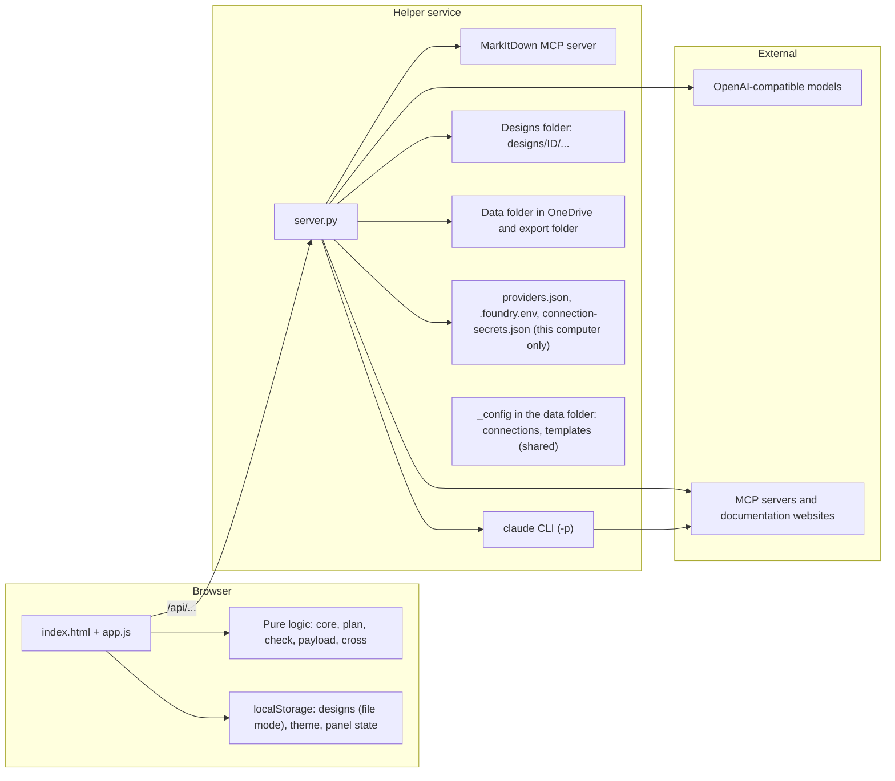
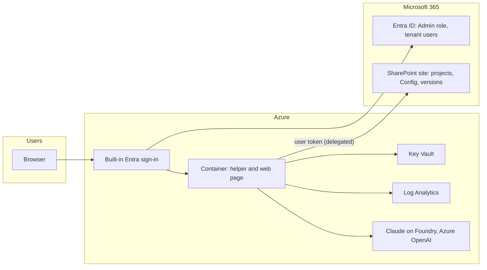

# DESIGN: DocHub (From Requirements to Architecture Design)

Status: **POC / POV**, the starting point for building the tool. This file is the detailed design, written so the tool can be rebuilt or extended from it. Facts come from the code. Anything not verified is marked **to confirm**.

## 1. Purpose, objectives and scope

- **Goal:** take source PRDs through one consolidated PRD, requirements and BPMN, a scenario matrix, a test plan, a payload library and an architecture design, and keep them consistent.
- **POC:** shows the flow, data model, AI steps and consistency checks work end to end.
- **POV:** shows the output helps a team (questions below).
- **No sample data:** the tool is generic. Documents follow the three document templates (PRD, Architecture design, Payload summary report); there are no downloadable import templates.
- **Single source of truth:** the consolidated PRD (page 1). Page 2 is read from it; later pages are built from earlier ones.

### What is real

| Area | In this POC |
| --- | --- |
| Flow, pages, data model, folder layout | Real |
| PRD parsing and issue checks, matrix checks, cross check, readiness verdict | Real, rule-based; rules are the first version |
| File conversion | Real through MarkItDown when `server.py` runs; Markdown sources are used as they are |
| Excel, CSV, zip, JSON, XML import and export | Real |
| Generate PRD, PRD analysis, scenario generation, payload linking, payload analysis, data model, readiness check, solutions, design, PRD and design updates, test refinement, build plan | **Real AI**: the built-in Claude CLI (`claude -p`) or any OpenAI-compatible model, chosen per step (section 12) |
| Documentation connections, project reference documents | **Real**: MCP servers and documentation websites queried live; the design cites the pages it used and links are checked |
| Document Repo in OneDrive, lock, change banner, activity log | **Real**: projects live in a OneDrive folder; every file is versioned by OneDrive; the tool adds a soft lock, a revision check and an activity log |
| Export folder | **Real**: every page as Markdown with a README; edits read back |
| Test execution | Not built; the plan is the baseline for Playwright |
| Storage, users, security | Single user, local, no sign-in |

### POV questions (to confirm)

- Does one standard PRD save effort and surface conflicts earlier?
- Do the cross check and the AI analyses find real inconsistencies on real documents?
- Is the payload library (schema, evidence list, matrix mapping) useful for tracking what is proven?
- Is the generated architecture design a good first draft against the team's own design?
- Which rule-based checks most need a model (section 17, backlog B-02)?

### Scope

- **In:** pages 1 to 7, data folder in OneDrive and export folder, MarkItDown, import and export, cross check, AI steps with several models, documentation connections, project references, themes.
- **Out (today's build):** test execution, direct SharePoint sign-in, multi-user editing, authentication, hosting. A hosted, multi-user service (section 18) is deferred.

## 2. Architecture

| Part | Role |
| --- | --- |
| `src/web/index.html` | Static shell: motto and top bar, design list, 7 stage sections, file inputs, toast. No framework |
| `src/web/js/app.js` | All UI: rendering, state, events, storage, diagram drawing, exports, AI calls. One IIFE |
| `src/web/js/core.js` `plan.js` `check.js` `payload.js` `cross.js` | Pure functions on `window.Core`. No DOM, no network. Testable in Node |
| `src/server.py` | Python standard library (plus optional markitdown). Static hosting, design storage, conversion, AI (Claude CLI or OpenAI-compatible, with a tool loop for documentation), connections, providers, project folder. Binds to 127.0.0.1 and only answers pages opened from this computer |
| `start.command` | One-step launcher: asks for the Foundry details once, offers to install MarkItDown, checks Claude, starts the server |
| `config/markitdown.mcp.json` | MarkItDown MCP server config (only the `markitdown` entry is started, and only if its command exists) |
| `providers.json` (root; example in `config/providers.example.json`), `~/.dochub/connection-secrets.json` | This computer only: AI providers, keys and the model per step; connection tokens and approved local programs. Owner-only; secrets never sent to the browser; not committed |
| `.pydeps/` | MarkItDown installed by the Install button or `start.command`; not committed |
| `.gitignore` | Secrets, user data (`designs/`), caches, logs, OS and editor files |
| `src/templates/` | The templates that ship with the tool; copied into `_config/templates/` of a data folder the first time. The working copy is shared (section 5.4) |
| `tests/e2e.py` | Playwright test of every screen (written, not yet run) |
| `src/web/css/`, `src/web/assets/` | Styles (tokens, base, app) and the logo. The server serves only `src/web`, never the project root |
| `doc/` | README (user guide), PRD, this design, plans and reviews |
| `scripts/build_package.py`, `VERSION` | Builds `dist/dochub-<version>.zip` from code and docs only (no data, keys or dependencies) |

- **Two modes.** Opened as a file: designs in browser storage, no AI, no conversion. Served by `server.py`: designs are folders, conversion and AI are real.
- **Load order** (each file extends `window.Core`): `js/core.js`, `plan.js`, `check.js`, `payload.js`, `cross.js`, `app.js`.

## 3. Page flow

| # | Page | Source | Main outputs |
| --- | --- | --- | --- |
| 0 | Designs list | storage | create, open, delete (two-click), export and import all designs; global AI models and reference connections |
| 1 | PRD library | uploaded files | Markdown sources (used as they are) or converted files, Generate PRD, versions, issues (after Analyze with AI) with fix options, AI update, exports |
| 2 | Requirements and BPMN | page 1 (live) | scope, one diagram per process, requirements |
| 3 | Scenario matrix | page 2, an imported workbook, or AI | editable rows, AI fields, filters, checks, matrix review, Excel export |
| 4 | Test plan | page 3 | test cases, coverage, Playwright skeletons |
| 5 | Payload library | imported folder, zip or files | schema, payload list and detail, AI analysis, coverage, report |
| 6 | Architecture | pages 1 to 5 (4 and 5 optional), references | references, readiness check, solutions with pros and cons, design, AI update |
| 7 | Build plan | pages 2 and 3 | AI modules, dependencies, tasks, estimates, guardrails, agent files |

- **Continue buttons:** "Next: ..." runs the next page; "Generate remaining pages" runs the rest. Page 5 is only shown; the analysis runs from its own button.
- **Reset** (pages 1, 3, 4, 5, two-click) clears only that page's data and folder. "Clear generated pages" clears matrix, tests, design, build plan and AI results.
- **Cross check** at the top of pages 1 to 6 (section 9).
- **Design bar:** All designs, name, Shared folder, AI model, Sync from folder, Save all to folder, Clear generated pages.

## 4. Data model

One design is one JSON object (`design.json`, or an entry in `localStorage['dochub-designs-v1']`).

| Field | Content |
| --- | --- |
| `id`, `name`, `created`, `updated` | identity |
| `rev`, `savedBy`, `savedAt`, `archVersions[]` | revision counter written by the server on each save and used to refuse stale saves; design versions `{id, t, label, md}` |
| `sources[]` | `{name, type, size, md, engine, mtime?, url?, text?, error?}`; a Markdown source has `md` at once and engine `Original Markdown` |
| `prd`, `versions[]`, `dismissed[]` | consolidated PRD, history (max 30), accepted PRD issue keys |
| `aiIssues` | `{hash, at, model, issues[]}`: AI findings on the PRD (`severity`, `type`, `where`, `text`, `prompt`, `fixes[{label, prompt}]`, `key`); cleared when the PRD is regenerated, imported or pasted; the issue list stays empty until Analyze with AI runs |
| `matrix[]` | `{id, ch, cat, kind, name, title, reqs[], expect, so, prio, extra{}, aiInfo?, reqInfo?}`; `reqInfo` = `{via: 'source columns' or 'AI', confidence, reason}` for the requirement link. `name` is the source name; `cat` category; `kind` type; `so` the Payload column; `title`, `expect`, `reqs` are AI fields; `aiInfo` = `{confidence, evidence, note, at}` |
| `matrixSrc`, `matrixGen` | where the matrix came from and the saved column map; AI generation info |
| `tests[]` | `{id, scenario, title, drives, prio, reqs[], status, steps[], expect, notes}` |
| `payloadImport` | `{name, at, count, skipped[], size, files?, sources[]}`; `sources[]` = `{name, at, total, added, replaced, count, paths}`; `files` kept inline up to about 1.5 MB, else in the folder |
| `payAi`, `payMap`, `erAi`, `payReport` | AI mismatches, matrix issues and suggested scenarios; payload to scenario to requirement map; AI data model `{mermaid, at, entities}`; summary report `{md, at, key}` |
| `archMd`, `archAssess`, `archDec`, `archAnswers`, `archDismissed` | design Markdown; readiness check `{at, key, verdict, summary, issues[] ({type: Conflict|Missing|Confirm, where, text, fixes[{label, decision}]}), options[], optAt}` (verdict is empty when only Find solutions was run; an option has 3 or more choices, `recommended`, `reason`, and `manual: true` for the user's own decisions); chosen options `{choice, note, manual{name, summary, pros[], cons[]}}`; dismissed issues |
| `tplPick` | per-design template choice per type `{prd, architecture, payload-report: templateId or 'none'}` (empty = the default, or AI decides) |
| `connUse`, `refDocs[]`, `archAi` | ids of the global connections this design uses; project reference documents `{name, md, size, at, from}`; last architecture AI run `{at, model, conns[], docs[]}` |
| `shareDir`, `shareHash`, `shareAt` | project folder path; hash of every file last written or read; last save |
| `archReview`, `resolved` | design review `{at, model, key, summary, issues[]}` (issues with severity and fixes[], `key` = hash of the design and the decisions); `resolved` `{prd: {issueKey: {at, fix, how}}, arch: {...}}` for issues whose fix was applied (`how` is `update` or `hand`) |
| `buildAi` | AI build plan `{at, model, modules[{name, reqs[], dependsOn[]}], tasks[{req, title, hours}]}`; waves, subtasks and the diagram are derived |
| `cc`, `ccDismissed` | last cross check `{all: {at, key, findings[], readiness}}`; dismissed finding keys |
| `guardrails`, `flags`, `fileHash` | build guardrails; progress flags; hashes for folder edits |

- **UI state** (`st` in `app.js`) is not saved: busy flags, filters, selection, proposals, undo buffers, progress.
- **Derived, never stored:** the requirements model (`model()`, cached by PRD hash) and the payload analysis (`payAnalysis()`, cached by import, matrix and PRD).
- **Staleness:** `hashStr` (djb2) of PRD, matrix, tests, payload import, design; a stale hash shows "changed after this".

## 5. Folders

### 5.1 Designs folder

`./designs`, or `--data-dir` / `DESIGN_DATA_DIR`. The system of record.

| Path in `<data folder>/<design name>/` | Written by |
| --- | --- |
| `design.json` | every save |
| `01-sources/` | uploads (read-only to the app) |
| `02-consolidated-prd/prd.md`, `versions/` | PRD edits and versions |
| `04-scenario-matrix/scenario-matrix.xlsx`, `.json`, `imported/` | matrix edits, imported workbooks |
| `05-test-plan/test-plan.md`, `.csv`, `tests/*.spec.ts` | test plan edits |
| `06-payload-library/imported/`, `summary-report.md` | payload import (parsed JSON; path separators written as `__`), report |
| `07-architecture/architecture.md` | design edits |
| `08-build-plan/tasks.csv`, `guardrails.md`, `CLAUDE.md`, `AGENTS.md` | build plan |

- **Write:** after each step (`publishLive`) or on demand (`publishAll`). **Read:** "Sync from folder" (also on opening) re-reads `prd.md`, `scenario-matrix.xlsx`, new sources, and Markdown sources whose file changed (never converted) when their hash or time differs.
- **Conflicts:** last save wins.
- Payload imports are saved in batches of 25 files.

### 5.3 Document Repo: a folder inside OneDrive

- **Why this route:** a program can call SharePoint or Graph as the user only with an Entra application identity. The decision is that the tool stays a user application with no registration, so it reads and writes a local folder and the OneDrive client, signed in as the user, shares it. How the team folder reaches each user's OneDrive (own folder shared, shortcut to a shared folder, synced Teams or SharePoint library) is the user's choice; the tool only needs the local path.
- **Setting:** `~/.dochub/settings.json` `{dataDir, userName, webUrl}` (outside the tool folder; local to each user). `DATA` is chosen from `--data-dir`, then `DESIGN_DATA_DIR`, then this setting, then `./designs`. `PUT /api/settings` validates the folder (absolute, inside the home folder, not inside the tool folder, writable), copies the existing projects that the new folder does not have yet (the originals stay), and switches `DATA` at once. the folder is chosen with `POST /api/pick-folder`, which opens the operating system's folder dialog on this computer (`osascript` on macOS, a PowerShell folder dialog on Windows, `zenity` or `kdialog` on Linux; a browser cannot return a full path) and returns the path, starting in a OneDrive folder found by `onedrive_roots()`; without a dialog the field becomes editable. `webUrl` only feeds the Open in OneDrive link; `POST .../reveal` opens the project folder in Finder, Explorer or the file manager.
- **Folder = design name:** the project id is the folder name. `folder_from_name` makes it file-system safe (`/` and `:` to ` - `, `\ * ? " < > |` and control characters to `-`, spaces tidied, no leading or trailing dot or space, no leading `~$`, at most 80 characters, reserved names such as `CON` and `Forms` get ` design`); the result maps to itself, so the server accepts only ids that equal their own `folder_from_name`. Names are unique case-insensitively: `POST /api/designs {name}` creates the folder (409 when taken), `POST .../rename {name}` renames the folder, rewrites `id`, `name` and the source links in `design.json`, and is refused with 409 for a name in use; `PUT /api/designs/<id>` never creates a folder. At start (and after the data folder changes) `migrate_design_folders` renames folders that still have a generated id to the design name (a duplicate becomes `<name> (2)`). A folder renamed outside the tool shows under its new name. Percent-encoded ids in URLs are decoded once in `_split`.
- **Revision check:** every `design.json` carries `rev`, `savedBy`, `savedAt`. `PUT /api/designs/<id>` is refused with 409 when the file's `rev` differs from the one sent (unless `X-Force: 1`); the server caches `(mtime, rev)` to avoid re-reading; writes are atomic (temp file, then replace). The client serialises saves so each carries the revision of the previous one.
- **Damaged file:** `read_design_file` repairs a `design.json` that has extra characters after the JSON (keeps `design.json.damaged-<time>`, writes the valid part back); an unreadable file is listed with `damaged: true` and its error instead of being skipped, and opening it returns 422.
- **Lock:** `<project>/.dochub-lock.json` `{session, user, since, beat}` written by `PUT .../lock`, renewed every 60 s, stale after 150 s, released on close; another session gets 409 (read-only mode, or `takeOver`). Read-only mode blocks saves, file writes and AI.
- **Change capture:** `GET .../meta` (revision, author, time) and `.../tree` (file times) polled every 30 s while the design is open and the tab visible; banners for a newer revision and for changed `.md`, `.xlsx`, `.csv` files (own writes are ignored through the times the server returned). OneDrive's own version history covers who and when for every file.
- **Activity log:** `<project>/_activity.jsonl`, one JSON line per event (`opened-for-editing`, `lock-taken-over`, `saved` at most every 5 minutes, `closed`, `ai` with step and model). `GET .../activity` returns the last 200.
- **Versions:** `D.versions` (PRD) and `D.archVersions` (design) keep up to 500 labelled snapshots with their text and also write `versions/<time>-<label>.md`.
- **Limits:** the lock and the change banner depend on OneDrive syncing in time (seconds to minutes); two people editing the same project during a sync delay can still conflict, which the revision check turns into a visible choice instead of a silent overwrite.

### 5.4 Shared configuration: the `_config` folder

One folder inside the data folder holds what the whole team uses; it travels with the projects through OneDrive. What depends on one computer stays local.

| Where | What | Scope |
| --- | --- | --- |
| `<data folder>/_config/connections.json` | Reference connections: documentation websites, MCP servers over HTTPS, local MCP programs (name, address, command, description, link) | Team |
| `<data folder>/_config/templates/` | `index.json` (templates and the default per type) and one `<id>.md` each | Team |
| `~/.dochub/settings.json` | Document Repos (list and the one in use), your name, OneDrive web address | This computer |
| `providers.json`, `.foundry.env` | AI models, keys, model per step | This computer |
| `~/.dochub/connection-secrets.json` | Connection tokens (`headers`, `env`) and the approved local programs (`<id>:<hash of command and arguments>`) | This computer |

- **Creation:** `ensure_config` runs at start, when the data folder changes and on every read: it creates `_config`, copies the shipped `templates/` the first time, and moves an old local `connections.json` into the shared file (tokens go to the local secrets file, the old file is renamed `connections.json.moved`, programs written by this user are approved). When a user switches data folder with copying on, `_config` is copied along.
- **Safety:** a local program in the shared file would run code on every teammate's computer, so `load_conns` marks it `blocked` until that computer approves it (`POST /api/connections/<id>/approve`, stored as a hash of the command and arguments; changing the command blocks it again). Blocked programs are not started by the Claude CLI route, the tool loop or the test. Tokens are never written to the shared file; saves from the page write only the shared fields.
- **Reserved name:** `_config` is not a design; a design with that name becomes `_config design`, and the folder is not listed as a project.
- **Concurrency:** both files are written atomically; a teammate's change is read on the next request. No locking: the last save wins.

### 5.2 Export folder (local folder only)

Hidden when the data folder is inside OneDrive (`applyOdMode`, from `settings.synced`; buttons marked `data-localonly`): OneDrive saves and shares the project, so the Export folder, Save all and Sync from folder buttons are not shown. Reading edited files on opening and the Sync now banner remain.

A folder per design (for example inside OneDrive), set with the **Export folder** button (`shareDir`); it must be inside the user's home folder and never inside the tool folder. It is for readers; the working data stays in the data folder (5.3).

| Path | Content | Read back |
| --- | --- | --- |
| `README.md` | files, sources, references, AI used, how generated, editing rules | no |
| `01-sources/<name>.md` | sources as Markdown | no |
| `02-consolidated-prd/prd.md` | the PRD | yes |
| `04-scenario-matrix/scenario-matrix.md`, `.xlsx` | table copy; workbook | workbook |
| `05-test-plan/test-plan.md`, `06-payload-library/summary-report.md` | reports | no |
| `07-architecture/architecture.md`, `decisions-and-options.md` | design; readiness issues, options, pros and cons, decisions | design |
| `08-build-plan/*.md` | guardrails, CLAUDE.md, AGENTS.md | no |
| `09-references/*.md` | project reference documents | yes (new and changed) |

- **Save all to folder:** writes only files whose content changed and stores a hash of each (`shareHash`). **Sync from folder:** applies a file only when its hash differs from the stored one. Last save wins; there is no merge.

## 6. Server API (`server.py`)

| Method and path | Purpose |
| --- | --- |
| `GET/PUT /api/settings` | Document Repo list and the one in use (`instances`, `active`), user name and OneDrive web address (section 5.3) |
| `GET .../designs/<id>/meta`, `GET/PUT/DELETE .../lock`, `GET/POST .../activity`, `POST .../reveal` | revision and author, soft lock, activity log, show the folder on this computer |
| `GET /api/health` | `{ok, markitdown, engine, mcpConfig, dataDir, ai (any provider usable), claude, aiModel, aiProvider}`; probed with a 1.5 s timeout to choose server or browser mode |
| `GET /api/designs`, `POST /api/designs`, `GET/PUT/DELETE /api/designs/<id>`, `POST .../rename` | list, create (unique name), read, save, delete, rename the design and its folder (`<id>` is the folder name, percent-encoded) |
| `PUT/DELETE /api/designs/<id>/sources/<name>` | upload (50 MB max), remove |
| `POST /api/designs/<id>/convert/<name>` | convert a source to Markdown (not used for Markdown sources) |
| `POST /api/markitdown/install` | pip install MarkItDown with the Word, PDF, PowerPoint and Excel readers into `.pydeps`, then load it |
| `GET/PUT /api/designs/<id>/artifact/<step>/<path>`, `GET .../tree`, `DELETE .../step/<folder>` | step-folder files, listing, Reset |
| `GET /files/<id>/<name>` | open a source read-only |
| `POST /api/ai/analyze-prd` | PRD issues `{severity, type, where, text, prompt}` |
| `POST /api/ai/gen-scenarios` | scenarios for a batch of requirements |
| `POST /api/ai/fill-scenarios` | scenario, expected outcome and requirement IDs from payload digests |
| `POST /api/ai/analyze-payloads` | `mode`: `match` (payload to scenario), `mismatch` (matrix vs payload), `review` (matrix issues, missing scenarios), `er` (Mermaid data model), `reqs` (scenario to requirement IDs) |
| `POST /api/ai/arch-assess`, `arch-options`, `arch-review`, `gen-arch` | readiness issues and options; options only (find solutions); the design Markdown |
| `GET/PUT /api/connections` | global connections: documentation website (`site`), MCP over HTTPS (`http`), local MCP program (`stdio`). Secrets never returned; PUT adds https entries only and keeps commands, env and headers as written in `connections.json` |
| `POST /api/connections/test`, `/<id>/test`, `/<id>/ask` | try an address before adding (public https only); test a saved connection (tool list or page title); a real AI call limited to that source with link check |
| `GET/PUT /api/providers`, `POST /api/providers/<id>/test`, `/models` | AI providers and the model per step (section 12.1) |
| `POST /api/folder/check`, `write`, `read` | project folder inside the home folder (never inside the tool folder): list, write files and read files; `.md .xlsx .csv .json .ts .txt` only |
| `GET /api/templates`, `GET/PUT/DELETE /api/templates/<id>`, `PUT /api/templates/defaults` | template library: list with defaults and types, read, create or update, remove, set the default per type (ids `[a-z0-9-]`, types `prd`, `architecture`, `payload-report`, up to 200,000 characters) |
| `POST /api/ai/gen-prd` | Generate PRD: all ready sources and an optional template; returns the PRD Markdown |
| `POST /api/ai/compose-doc` | reshape a draft (the payload report) into a template without losing content |
| `POST /api/ai/refine-test`, `build-plan` | edited test case with notes; modules, dependencies and tasks |

Every `/api/ai/*` call accepts `connections` (ids) and returns `model` (the one used); the model comes from the global step and default choice.
| `POST /api/ai/update-doc` | edit of the PRD or the design from an instruction (`kind`: `prd` or `arch`) |

- **Conversion order:** the MarkItDown MCP server (only when its command, for example `uvx`, exists; stdio JSON-RPC, 180 s), then the Python package (also from `.pydeps`). Markdown sources skip conversion.
- **Security:** 127.0.0.1 only, no sign-in; Host and Origin must be local (other web pages get 403). Provider and connection secrets are write-only. Connection tests and the page reader only open public https addresses. Ids match `[A-Za-z0-9_-]{1,64}`; names reject slashes, leading dots and NUL; step folders come from a fixed list; resolved paths stay inside the design folder. Uploads are served with `Content-Security-Policy: sandbox`; HTML and SVG as plain text; `nosniff`; `no-store`. Static files: only `.html .css .js .svg .ico .png .json`, never from the data folder.
- **Errors:** 404 on an AI path means the server is out of date; the page says so.

## 7. Core logic (pure functions)

**core.js:** `parsePrd` (sub-bullets under a label such as `Consent sources:` in a scope list are joined into that one scope item; reads both the compact layout and template-style PRDs; a PRD that uses `#` for its sections is shifted down one level first; IDs may have several segments such as `BR-CUST-001`; acceptance criteria, rules and glossary tables under a requirements heading are not counted: scope under any heading containing Scope, one process per `###` under a Process heading with `Current state` / `Future state` sub-headings ignored, a requirement table with an ID column or `### REQ-012 — Title` records with a `Main behavior` or `Requirement statement` row; Data, Integration and Non-functional sections are not counted as requirements), `mergeSources` / `buildPrdMd` (rule-based, unused since Generate PRD is AI: backlog B-04), `requirementsModel` (`{title, inScope, outScope, processes, reqs}`), `genFlow`, `genScenarios` (rule-based rows, used only when a scenario is added before a matrix exists), `xlsx`, `zip`, `matrixSheets` (matrix sheet with Name and Category, AI fields last, and a Traceability sheet), `hashStr`, `chanOf`.

**plan.js:** `diffLines` (LCS), `planBuild` (the old word-overlap plan, now only a fallback for designs without an AI build plan), `toJson`, `toCsv`, `agentFile`, `tasksCsv`. `proposeUpdate` (rule-based PRD edits) is unused (backlog B-04).

**check.js**
- `analyzePrd`: issues typed Conflict, Decision needed, Gap, Wording.
- `analyzeMatrix`: Conflict, Missing, Quality; rows waiting for a payload are one Missing finding. Rows marked Not required are ignored.
- Matrix reading: `parseCsv`, `readXlsx` (own unzip via `DecompressionStream('deflate-raw')`), `readMatrixSheet` (header detection; auto map of key columns Name or Scenario ID, plus Category, Type, Priority, Channel, Payload), `applyMatrixMap`. Scenario, Expected outcome and Requirements are mapped only for a file in this tool's own layout (has a Name column next to them); otherwise they stay blank and the file's columns are kept as extra columns.

**app.js helpers** (not pure): `mergeSimilar` (near-duplicate issues become one, with the combined places and fix options), `fixesOf` / `fixesHtml` / `toggleFix` (fix options and prompt bullets), `planFromAi`, `shareFiles` / `shareReadme`.

**payload.js** (section 13): formats (`parsePayloadText`, `xmlToJson`, `csvToJson`, `readPayloadZip`), grouping (`payloadLevel`, `buildGroups`), entity model (`buildErModel`, `keyEr`, `erMermaid`), `groupTable`, `groupMatches`, `groupEvidence`, `groupDigest`, `payloadInconsistencies`, `matchPayloads`, `analyzePayloads`.

**cross.js:** test plan (`genTests`, `specSkeleton`, `testsCsv`, `planMd`, `specsZip`, `coverage`), `crossCheck(page, ctx)` (ends with `groupFindings`: findings of one kind become one entry), `readiness(ctx)`, `blankArch`. `refineTest` and `proposeArchUpdate` are unused (backlog B-04): refinement and design updates are AI.

## 8. UI design

- **Look:** Hallmark skill, modern-minimal, theme Cobalt, app scope. Light by default. `tokens.css`, `base.css`, `app.css`.
- **Shell:** motto and title on one row with the storage note and theme icons; design bar (All designs, name, History, and for a local data folder Export folder, Sync from folder, Save all to folder, plus Clear generated pages) with panels under it for the export folder and the history; stage tabs (each shows what its stage produced); page; sticky bottom bar.
- **Panels:** title on the left, notes and buttons on the right, collapse chevron last; a button row inside a panel body sits on the right with its note on the left. Every panel collapses, including the Designs page and the design-bar panels; "Collapse all sections" per page; state kept in `localStorage['dochub-panels-collapsed']` (the cross check shares one state on all pages).
- **Lists:** a table directly inside a panel scrolls in a fixed-height box (about 60 to 70% of the window) with a sticky header; the scenario table uses most of the window height; "Full height" for long lists. Pages use the full width.
- **Master and detail:** test plan and payload library show the list on the left and the selected item on the right, both panels the same height and scrolling inside.
- **Find in text:** `enhanceFinders` adds a search bar (`mdFindBuild`) above `#prd-editor`, `#arch-editor`, every `.doc` preview and every code block of 12 or more lines; previews wrap matches in `mark.fh`, in editors the text sits on a transparent textarea over a hidden copy (`.mdmirror`) that paints every match, kept in step on scroll, resize and typing; the current match is also selected and scrolled to (measured with the copy) while the search box keeps focus.
- **Model in use:** `aiModelFor(step)` resolves the model like the server does (global step, global default, Claude CLI); `aiProgress` shows it, `#ai-now` in the design bar shows the running or last call (`setAiNow`), and the server returns the model of each call (for the Claude CLI the Foundry deployment name).
- **Progress:** every AI step shows a spinner, what it is doing, the model and elapsed time; buttons are disabled while it runs.
- **Severity:** colour and text (red Critical, amber Important, grey Minor), never colour alone.
- **Every region that loads data** has loading, empty (reason and one action), error and full states.
- **Controls:** two-click confirm for destructive actions; "proposal, diff, Accept or Discard, Undo" for prompt updates.
- **Accessibility:** tab roles and `aria-selected`, labelled icon buttons, `aria-expanded`, visible focus, reduced motion, text status next to icons.

### Themes
- `data-accent` on `<html>`: cobalt, rust, forest, violet, teal, derived with `oklch()`. `data-mode` light or dark; first visit follows the system. Stored in `localStorage['dochub-theme']`. Diagrams use CSS variables, so they follow.

## 9. Cross check and readiness

- One check, same on pages 1 to 6, stored in `D.cc.all` with a data key. It only reports.
- **Always runnable.** Compares the PRD issues (listed only after Analyze with AI; not dismissed), requirements, matrix, test plan, payloads, architecture (cited IDs) and build plan. Pages without data are listed as not compared.
- **Focus:** only key findings are shown. Findings with the same cause (same type, area and wording apart from IDs) become one entry that lists the first three IDs and the count; Minor findings (Unmatched, Quality) are hidden until "Show minor".
- **Findings:** type Conflict, Changed, Missing, Unmatched or Quality; severity Critical (Conflict), Important (Changed, Missing), Minor (Unmatched, Quality); area PRD, Requirements, Matrix, Test plan, Payloads, Architecture, Build plan. Sorted by severity; filters for severity, type and area; Dismiss per finding (`ccDismissed`, matched on type, location and text).
- **Payload findings are per payload,** not per file: a payload with no scenario is one finding; call checks run only on files with a request and a response.
- **Page 6 verdict:** Blocked (no PRD or no requirements), Ready with risks (requirements with no scenario, P0 or P1 with no payload when payloads exist, payloads that disagree with the matrix, unapproved proposed requirements, open PRD decisions), Ready.
- On page 6 each finding, blocker and risk has "Use in prompt"; "Add all issues to the prompt" fills the design update prompt.

## 10. Rendering

**Diagram renderer** (`app.js`, no Mermaid library): `parseFlow` / `renderFlow` for flowcharts (nodes `[ ]`, `{ }`, `(( ))`, edges with `|label|`, `subgraph` lanes); `erDiagram` uses `parseEr2` / `renderEr2` (refined ER): entity cards (name header, key badges, type and note columns, up to 14 fields), layers by distance from the most connected entity with barycenter ordering, elbow lines with crow's-foot ends (one, many, optional, required), dashed lines for `..` relations, self relations as a loop, lines that skip a column routed over the top, labels on a free spot. Every other Mermaid type is drawn by the official Mermaid library (below). The old `parseEr` only counts the entities of an AI-drawn data model and `renderEr` is unused (backlog B-04).

**Diagram routing and viewer.** `parseFlow` reads `subgraph` in all its forms (nested, with or without an id or a title), skips `direction`, `style`, `classDef`, `class`, `click` and comments, and supports `&` groups, labelled arrows (`|text|` and `-- text -->`), dotted and thick arrows (drawn solid) and the stadium, cylinder, subroutine, hexagon and slanted shapes (drawn as boxes). `renderFlow` ranks the nodes, orders the boxes in each lane and column with four barycenter sweeps, and routes every line as an elbow: out of the source horizontally, a vertical track in the gap before the target column, into the target horizontally, with rounded corners. The vertical tracks of the lines that enter one column are ordered by trying every permutation (up to 6 sources) and keeping the fewest crossings; a line that would pass through another box takes its track next to its own box. Remaining crossings of a horizontal over a vertical line are drawn as a hop (a 5 px half circle) on the horizontal line; lines that share a source or a target join and do not hop. Labels take the first free spot that touches no box and no other label. The column gap is 56 px.

`enhanceDiagrams` (called from the panel observer) wraps every `.diagram` that holds an SVG in a viewer: a toolbar, a scrolling view with drag to pan, Ctrl or Cmd plus wheel to zoom around the pointer (20% to 400%), Fit, a full-screen overlay, Copy (when the Mermaid source is known: `data-src`), and SVG or PNG download with the CSS variables resolved to real colours. `mermaidKind` picks the engine from the first line: `flowchart` and `graph` use `renderFlow`, `erDiagram` uses `renderEr2`, everything else (sequence, class, state, Gantt, pie, and so on) leaves a placeholder that `enhanceDiagrams` hands to `dvMermaidOnly`: the official Mermaid library draws it in the same viewer without the toggle; a declined or failed load shows the source with a retry button, and the static HTML export writes the source as a code block. Drawings are cached per source and theme. For flowcharts with a known source a **Mermaid** button swaps the swimlane drawing for the official Mermaid layout (`dvMermaid`, `securityLevel: strict`, `htmlLabels: false` so SVG and PNG export work) and back. The library is not bundled and is not loaded at start-up: `mermaid.min.js` from the tool folder if present; otherwise, after a confirmation, `POST /api/mermaid/install` makes the helper download `mermaid@11.4.0` from jsDelivr into the tool folder (size and content checked), and only if that fails does the browser load it from the CDN (the only external script the tool can load, and only on request). Exported HTML keeps the plain SVG without the viewer.

**Markdown preview** (`renderMd`): YAML front matter is shown as a collapsed "Document properties" table above the text, not as text; headings, lists (nested by indentation, bullets and numbers mixed, a blank line between items keeps one list), tables, quotes, code, bold, italic, links. Fenced `mermaid` is drawn; `svg` and `html` after `sanitizeMarkup` (allowlist: no scripts, styles, frames, forms, `foreignObject`, animation, `on*` handlers; links limited to http, https, mailto, `#`); every other fence is plain code. Raw HTML outside a fence is shown as text.

**Exports:** PRD (md and pdf by print, from the header buttons); matrix (xlsx); test plan (md, csv, spec zip); payload zip and summary report (md); architecture (md, pdf by print); tasks csv; all designs (json).

## 11. Key behaviours

- **Sources and PRD:** a Markdown source is read as text at upload and shows Ready; other types are converted with MarkItDown (the Install button sets it up if missing). **Generate PRD** sends all ready sources to the AI (`gen-prd`), which merges them into one PRD in the chosen template or a best-fit structure, and asks to confirm if a PRD exists. The result is checked with `parsePrd`: scope lists, processes with diagrams, requirement IDs of the sources missing from the PRD; the findings are shown above the editor. Every replace saves a version. A new PRD (generate, import, paste, folder sync) clears the AI issues and dismissed items; nothing is listed until Analyze with AI runs.
- **Matrix import:** header row detected; only a key column (Name or Scenario ID) is needed; otherwise the user picks it. The mapping and raw rows are saved; changing a mapping re-reads at once; AI fields are kept by ID.
- **Priorities:** P0 Critical, P1 High, P2 Medium, P3 Low, edge or future, plus Not required. The definitions, typical scenarios, regression expectation and quick test are in the `gen-scenarios` prompt and in the Priority rules panel (`PRIO_RULES`). Defaults for imported rows without a priority: Edge and Gap P2, others P1.
- **Requirement links:** two ways. A generated matrix carries the IDs (kept through export and import because the file has its own Name column). For an imported or typed matrix `linkRequirementsWithAI` adopts IDs already in the row, then asks the AI. The Requirement traceability table (page 3) is requirement-centred: requirement, scenarios, payloads through those scenarios.
- **Test cases:** created only for active scenarios, never overwritten; titles fall back to the scenario name.
- **Payload import:** like extracting a zip into a folder (same path overwritten, new path added); wrapper folders dropped; history kept (section 13).
- **Autosave:** edits save after 500 ms. The status line shows "Saved".

## 12. AI integration

**Transport (Claude CLI).** `server.py` runs `claude -p --output-format json --max-turns 1` (25 when documentation connections are used) with the prompt on stdin, in an empty temporary folder (so no project files are read), timeout 600 s, maximum 400,000 characters per call. Structured answers use a JSON schema in the prompt and are parsed from the result; documents use a `===NOTES===` / `===DOCUMENT===` format.

**Claude provider.** `.foundry.env` (written by `start.command`) is read at server start. When present it alone defines the environment of every AI call (`CLAUDE_CODE_USE_FOUNDRY=1`, resource, key, model pins); `ANTHROPIC_API_KEY`, OAuth tokens and Bedrock or Vertex flags are removed. Otherwise the CLI's own login is used. `/api/health` reports the provider.

**Prompts.** Every prompt ends with a concise-style rule: bullets and tables, one short sentence per field (25 words), no repetition, at most 3 IDs cited then a count; the architecture design stays about 100 lines.

| Step | Call | Notes |
| --- | --- | --- |
| PRD analysis | `analyze-prd` | Critical and Important only, at most 12 issues, related points grouped, each with 2 or 3 fixes; runs on demand only |
| Generate PRD | `gen-prd` | all ready sources (name and Markdown) and the template; rules: merge duplicates, keep every requirement and source ID, business view only, call out Scope, one BPMN-style Mermaid flowchart with swimlanes per business process, a table of all requirements with sources, proposed requirements kept apart, TBD instead of invention, template guidance text left out; no template means a best-fit structure |
| Template application | `compose-doc` | a fact draft plus a template; keeps every fact, ID and diagram; used for the payload report |
| Scenario generation | `scenario-plan`, `gen-scenarios` | the plan returns the high-level categories (usually 5 to 12), 3 to 8 channels and puts every requirement in one category; categories with fewer than two requirements are folded into the closest by shared words and at most 12 are kept; then up to 8 requirements per call with `maxLow` = ceil(0.25 × requirements, at least 1); no limit on P0 and P1; the prompt asks for journeys and variations, many IDs per scenario, one Gap at most, and carries the priority definitions; surplus P2 and P3 are dropped (P2 first, then success paths); IDs checked; one coverage pass per category; all-or-nothing |
| Payload match | `analyze-payloads` `match` | payloads no scenario names; High and Medium confidence written to the Payload column |
| Scenario fill | `fill-scenarios` | up to 3 scenarios per call (at most about 100,000 characters); a failed batch is reported and skipped; requirement text cut to 220 characters |
| Requirement link | `analyze-payloads` `reqs` | scenarios without requirements; IDs written in the row's columns are adopted first; the rest go to the AI in batches of up to 12 (about 60,000 characters) with the requirement list (200 characters each) and, if linked, 2 payload digests; IDs outside the PRD are dropped; a failed batch is retried one scenario at a time; failed IDs can be retried alone |
| Payload analysis | `analyze-payloads` `mismatch`, `review` | mismatches in batches of up to 12; review in one call |
| Data model | `analyze-payloads` `er` | given entities, fields, observed values, requirements, design excerpt; told to drop payload headers |
| Architecture | `arch-assess`, `arch-options`, `gen-arch` | assessment returns issues (at most 10, grouped, with fixes) and options; Find solutions returns every realistic choice (3 or more) with pros, cons, a recommendation and why; the design follows the chosen options and ends with a Sources table The optional baseline draft (`D.archBase`, read-only) goes into `archContext()` as the base document; options may carry `baselineChoice` and `baselineNote`, which `applyBaseline` stores as a decision flagged `fromBase` (chosen automatically, counted as decided). |
| Test refinement | `refine-test` | one test case, scenario and linked requirements; returns the changed fields and notes; shown as a diff |
| Build plan | `build-plan` | requirements with scenario IDs; returns modules, dependencies and one task per requirement |
| Updates | `update-doc` | PRD or design; returns notes and the full document; client shows a diff and checks the document did not change meanwhile |

- **Focus and grouping:** the issue prompts end with a rule to report only key missing information, logic problems, conflicts and real open decisions, group points with one cause into one issue, and respect the cap.
- **Button-only AI:** `aiPost` checks `st.userAi`, set by a click on a button with `data-act`, `data-go`, a test button or an id starting `next`, `runrest` or `gen-`; it lasts 30 minutes, is renewed by each call (so long pipelines continue), and is cleared in `route()` when a design opens. Otherwise the call is refused and logged.
- **Failure handling:** no output is invented. The step shows the reason: CLI missing, not signed in, server out of date (404), too much data, timeout. Retries once per call.
- **Pipeline (page 5).** `analyzeAllPayloads({from, failedOnly})` runs: link by ID, AI match, fill, compare and review, link requirements and map, report. Each step updates a status list. A failed step stops later steps, except the optional match step (marked skipped) and a partly failed fill step (the rest of the pipeline continues). A failed step can be retried from that step (earlier steps keep their state); the fill step can retry only its failed scenario IDs (`revFailedIds`, results accumulate). In the fill step a batch that fails twice is retried one scenario at a time; the server retries once when an answer is not valid JSON.

### 12.1 Providers and models (providers.json)

- **Built in:** the Claude CLI (section above), including live documentation tools.
- **OpenAI-compatible:** any service with `/chat/completions`: OpenAI, DeepSeek, NVIDIA NIM, AMD or other vLLM servers, Azure OpenAI, GitHub Models, Ollama. Defined once in `providers.json` (owner-only; API keys never returned to the browser; a key can also come from an environment variable). Presets fill the address, token parameter and key header.
- **Choice:** a default plus one model per step (`analyze-prd`, `gen-scenarios`, `fill-scenarios`, `analyze-payloads`, `refine-test`, `build-plan`, `arch-assess`, `arch-options`, `gen-arch`, `update-doc`, `ask`). The choice is global; there is no per-design override. Order: global step, global default, Claude CLI.
- **JSON answers:** the prompt carries the schema; JSON mode (`response_format`) is used when the provider supports it and no tools are active; one retry on invalid JSON.
- **Documentation connections for other models:** the helper runs the tool loop (max 20 turns). MCP tools (HTTP or local) are exposed as functions `<connection>__<tool>`; documentation websites through `fetch_doc_page` (public https, host-restricted, redirects checked, HTML to text, links listed). Results are cut to 15,000 characters. The same Sources rule and link check apply. A model flagged as not supporting tools is refused with a clear message when connections are ticked.
- **Safety:** keys are write-only; retries on 429 and 5xx (3 attempts).
- **Speed test:** `provider_test` asks for a ~120-word paragraph and returns `{ms, inTokens, outTokens, tps, estimated}`; tokens come from `usage` (`completion_tokens` or the Claude CLI's `output_tokens`), tokens per second is output tokens over the whole call time (includes the wait for the first token).
- **API:** `GET/PUT /api/providers`, `POST /api/providers/<id>/test`, `POST /api/providers/<id>/models` (lists `/models`).

### 12.4 Document templates

- **Library:** `<data folder>/_config/templates/` (shared with the team; seeded from `templates/` in the tool folder). A design picks per type: default (the library default for the type), a specific template, or `none` (the AI decides from the content).
- **Where used:** `gen-prd` (PRD), `gen-arch` (architecture; the template replaces the numbered section list, all other rules stay), `compose-doc` (payload report). Test plan and build plan documents are not AI-written and have no template (backlog B-24).
- **Preset:** `standard-agile-prd.md` is the supplied Standard Agile PRD Structure, cleaned of export escapes and the unloadable figure. Its sections are 0 Document Control to 15 Supporting References; Core sections are always kept, Conditional ones say Not applicable when empty.
- **Compatibility:** the generated PRD must still be readable by `parsePrd` (page 2 and the later pages are built from it), so `gen-prd` always produces a Scope section, a Process section with `###` per process and a Requirements section with a table of all requirements.

### 12.2 Fix options on AI issues

- Each AI issue on the PRD page and the Architecture page carries `fixes` (2 or 3 `{label, prompt}`); `fixesOf` adds "Record as an open item" and, for older results, the old `prompt`.
- A fix chip adds `- <prompt>` to the update prompt of that page; a second click removes it. The chip state is derived from the prompt text, so no extra state is stored. A custom fix is added as `- Regarding <where>: <text>`.
- The prompt is applied only when the user presses Propose the update; the diff is reviewed as for any update.

- **Resolved in line.** `fixMap` (session) maps each fix bullet in the prompt to its issue key. The update prompt asks the AI to write one note per `- ` instruction, in order, as `DONE:` or `NOT DONE:`. On accept, `resolveFromProposal` marks the issues of the DONE bullets in `D.resolved[kind]`; with no DONE or NOT DONE notes all bullets count as applied, with a different number of notes none are marked and the user is told to use Mark resolved. Resolved rows stay in the table (dimmed, with the fix and time, listed after the open ones and not counted); `Reopen` and `Mark resolved` toggle by hand; a new analysis clears the resolved list (PRD) or the keys of the old review (design).
- **Design review.** `arch-review` sends the project documents, the design and the chosen decisions; `ARCH_REVIEW_SYSTEM` reports only Critical and Important issues (contradiction with a requirement or chosen option, uncovered requirement or flow, missing key element, logic problem, unsupported statement), is lenient, and an empty list is a normal result; at most 10 issues, grouped, with 2 or 3 fixes each.

### 12.3 Documentation connections and project references

- **Kinds:** documentation website (`site`: address of the official docs), MCP server over HTTPS (`http`), local MCP program (`stdio`, edited in the shared `_config/connections.json` only and blocked on a computer until approved there). A design ticks the ones it uses (`connUse`) and adds project documents (`refDocs`, up to 20,000 characters each and 80,000 in total in the context).
- **Claude CLI:** MCP servers go in a temporary `--mcp-config` with `--strict-mcp-config --allowedTools mcp__<id>`; a website adds `WebFetch(domain:<host>)` and `WebSearch`; the prompt lists the sites and the Sources rule.
- **Other models:** the helper runs the tool loop (12.1).
- **Output rule (both):** cite only pages actually read, as links; end generated documents with a Sources table. After design generation `verify_links` requests every link on a connected host (public https, at most 40) and rewrites 404 or 410 links as "link not found".
- **Test with AI** (`/api/connections/<id>/ask`) proves a source works: one AI call limited to it, with the cited link checked.

## 13. Payload library design

**Parsing.** JSON, XML and CSV become one JSON structure on import. XML: attributes become fields (`@` prefix on a clash), repeated elements become lists, namespaces dropped, CDATA kept, numbers and booleans converted. CSV: delimiter detected, first row is the header, each row a record (first 2,000). Up to 5,000 files per import.

**Grouping.** `payloadLevel` finds the folder level whose folders are the payloads: the first level with more than one folder, skipping wrapper folders that hold everything. Stray files next to payload folders are ignored; several wrapper folders that each hold many payload folders are split; a single payload folder is recognised when few entity folders lie below its own files. Flat files become one payload each. The group key is the ID ignoring case, hyphens and punctuation. Known limit: a batch of 3 or fewer payload folders next to a stray file can be misread.

**Entity model** (`buildErModel`). Entity names come from the entity folder (`returns/` is Return) or the primary file (`order.json` is Order); a name that is or contains a payload ID or a long number is rejected. Wrappers are folded: `data.order` is the order, `nodes` and `edges` lists and single-array wrappers are lists, `shopMoney` sets are `money` fields. Keys that are identifiers are data, not structure. The primary entity is linked to each entity folder. `payloadInconsistencies` flags type conflicts, name variants, value variants, date formats, folder and body disagreements and optional fields.

**Key entities** (`keyEr`). The root entity (the primary file's entity) is always kept, with the entities linked to it (two hops get a smaller boost). Others are ranked by overlap of their names and fields with the requirements and the design text. Each entity keeps its key and most relevant fields and lists the requirement IDs it impacts. "Show all" disables the filter. The AI diagram replaces the rule-based one when drawn.

**List columns** (`groupTable`). From the primary files: the most informative scalar fields (key-name bonus, 2 to 12 distinct values favoured, identifiers penalised) up to 8; from the entity files: key fields per entity (up to 2 per entity, 5 in total) joined per payload; the file count per entity folder. A cell differing from the most common value (when at least half agree and there are at least 4 payloads) is flagged `diff`; a field present in most payloads but missing is `missing`. The list shows only facts that vary and are not unique per payload.

**Matching.** A scenario's Payload column is matched to payload IDs with a regex tolerant to hyphens and free text. Strong matches: the Payload column, a `scenario` field inside a payload, an `S-xx` in a file name. Wording is a weak match and is never written automatically. `linkPayloads` writes the payload ID into the column; if none names it, the ID is searched in the scenario's name and other columns.

**Imports.** `importPayloadFiles` drops a shared wrapper (using `payloadLevel`), then merges by path into the existing library, recording `{total, added, replaced, count, paths}` per import. If the earlier files cannot be loaded the import is refused. Removing one import removes its remaining paths.

**Reset** restores the Payload column from the saved matrix source (or empties it), blanks the fields that have `aiInfo`, and clears `payloadImport`, `payReport`, `payAi`, `erAi`, `payMap`.

## 14. Replication guide

**Run:** `python3 src/server.py [--port 8765] [--data-dir <folder>]`, `start.command` (macOS) or `start.bat` (Windows; finds `py -3` or `python` 3.10+, asks for the Foundry details with a hidden key prompt, offers MarkItDown, checks Claude, opens the browser). `.gitattributes` keeps CRLF in `.bat` and LF in `.command`.

**Platforms (macOS and Windows).** Folder dialog: `osascript` or a PowerShell `FolderBrowserDialog` (zenity or kdialog on Linux); show folder: `open` or `explorer`; OneDrive folders found from `~/Library/CloudStorage/OneDrive*`, `~/OneDrive*` and the OneDrive environment variables; `atomic_write` retries `os.replace` (a file held by OneDrive or a scanner fails briefly on Windows) and falls back to a direct write; `long_path` adds the `\\?\` prefix for artifact paths over 240 characters; project folder names avoid Windows reserved names and characters; settings live in the user profile. Not shared between people: everything except the project folder (see the README table). Per-computer values never go into `design.json`: the export folder path, its hashes and time are kept in the browser (`dochub-export-<design>`). `GET .../meta` also returns `conflicts`, the OneDrive conflict copies of `design.json`, shown as a banner. Tested on Linux with two helper instances sharing one folder (create, list, open, lock, stale save, conflict copy, activity); the Windows launcher, the folder dialog and long paths are untested. MarkItDown: the Install MarkItDown button (or `start.command`) installs it into `.pydeps` (Python 3.10 or newer), or use `uv` for `uvx markitdown-mcp`. AI: the `claude` CLI, or an OpenAI-compatible provider added on the Designs page. Node (`npx`) only for local MCP programs such as `@shopify/dev-mcp`.

**Rebuild order**
1. `tokens.css`, `base.css` from the Hallmark scaffold, then `app.css`.
2. `core.js`, `plan.js`, `check.js`, `payload.js`, `cross.js` (each extends `Core`).
3. `app.js`: helpers, storage, state, stages, pages 1 to 7, diagram renderer, export, cross check, AI helpers, panel collapse, theme, wiring (one delegated click, input, change and keydown listener).
4. `server.py`, `markitdown.mcp.json`, `start.command`, `.gitignore`.

**Rules to keep**
- No framework, no build step, no external scripts; Google Fonts is the only automatic network load and the page works without it. The only other external script is the official Mermaid library, loaded on request from the tool folder or the CDN (section 10).
- Pure logic stays out of `app.js`.
- A check never writes to the PRD, matrix or tests; AI changes to documents go through a diff and Accept.
- Escape all text with `esc()` or `ea()`; never insert uploaded markup except through `sanitizeMarkup`.
- Never fake AI output.

## 15. Testing

- `tests/e2e.py`: Playwright checks of every screen, the templates, the payload imports and the AI steps. **Written, not yet run.**
- Logic was checked in Node with stand-ins for the DOM and the AI (grouping, parsing, matching, key columns, pipeline steps, import merging, report) and `curl` against the server with a stand-in `claude`.
- The providers and tool loop were checked against a stand-in OpenAI-compatible server and a stand-in MCP server (JSON mode, tool calls, key secrecy, owner-only file, tool-less model refused, Origin check); folder write and read, path rules and link checking were checked with local servers.
- Not done: any browser run, any run against real documents, real providers, Microsoft Learn or shopify.dev (backlog B-30, B-31).

## 16. Known limits and open items (to confirm)

- AI quality is unverified on real data; results need review.
- Payload analysis is generic: field choice, highlighting and key-entity ranking may miss what a domain expert considers key. Call patterns and payment checks need request and response payloads.
- Grouping edge case (section 13). XML and CSV support is basic.
- Diagrams: the built-in drawing covers flowchart, graph and ER only; every other type needs the official Mermaid library (from the tool folder or the CDN).
- Team sharing is by OneDrive sync only: soft lock, no sign-in, no roles (section 5.3; hosted design in section 18 is deferred).
- `.foundry.env`, `providers.json` and `~/.dochub/connection-secrets.json` hold keys and tokens in plain text (owner-only).
- Reading documentation websites with the Claude CLI relies on its web tools; they may be unavailable on some providers, in which case an MCP connection is the fallback.
- Rule-based leftovers and unbuilt features are listed in the backlog (section 17).

## 17. Backlog (future phases)

**Next:** team sharing through the OneDrive data folder is built (section 5.3). Sign-in, roles and a hosted service (B-12, B-16) and Microsoft Copilot as an optional text-only provider (B-21) are deferred; Copilot is not planned as the primary model.

Everything that is a stand-in, a leftover or not built is listed here. Nothing in this table is offered as a working feature in the interface.

### 17.1 Stand-ins and leftovers to replace or remove

| ID   | Item                                | Today                                                                                                         | Target                                                         | Phase |
| ---- | ----------------------------------- | ------------------------------------------------------------------------------------------------------------- | -------------------------------------------------------------- | ----- |
| B-01 | Text conversion without `server.py` | Browser-only mode reads text files directly and labels the engine "simulation"; other types get a placeholder | Remove browser-only mode, or run MarkItDown in the browser     | 2     |
| B-02 | Rule-based checks                   | PRD issue checks, matrix checks, cross check and the readiness verdict use first-version rules                | Tune the rules on real data; add AI checks where rules miss    | 1     |
| B-03 | Rule-based scenario rows            | `genScenarios` builds rows only when a scenario is added before a matrix exists                               | Remove; start from an empty matrix                             | 2     |
| B-04 | Unused rule-based editors           | `proposeUpdate`, `proposeArchUpdate`, `refineTest`, `mergeSources`, `buildPrdMd`, `renderEr` and their help texts remain in `plan.js`, `cross.js`, `core.js` and `app.js`    | Delete the dead code                                           | 2     |
| B-05 | Rule-based test creation            | One test case per scenario from a template                                                                    | AI-written steps and assertions from the scenario and payloads | 2     |
| B-06 | Rule-based module estimate fallback | Designs generated before the AI build plan still show the word-overlap plan until regenerated                 | Regenerate, then remove `planBuild`                            | 2     |
| B-07 | Rule-based design `blank` start     | `blankArch` template                                                                                          | Keep or replace by an AI first draft                           | 3     |

### 17.2 Features not built

| ID | Item | Why it matters | Phase |
| --- | --- | --- | --- |
| B-10 | Model comparison and cost | Providers and a model per step exist (section 12.1). Still to build: cost and time per call, and a side-by-side comparison of two models on the same step | 2 |
| B-21 | Microsoft 365 Copilot as an optional provider | **Planned, section 18.5.** All users hold E7. Beta Chat API, delegated only, text only: optional for drafting steps after sign-in exists and a short test; not the primary model | After B-12 |
| B-25 | Mermaid features the renderer does not draw | Dotted and thick line styles, node styling and `classDef`, nested subgraphs as separate pools, `click`, and every diagram type except flowchart, graph and ER in the built-in drawing; a line that skips several columns can still cross a box in between | 3 |
| B-24 | Templates for the test plan, build plan and scenario matrix documents | These are built by rules or as data; an AI step that writes the test plan document from the matrix and test cases would let a template apply | 2 |
| B-23 | Fix options for the other AI results | Only the PRD and Architecture pages have fix options and an update prompt; the matrix review and payload mismatches do not | 2 |
| B-22 | Streaming and token budgets for OpenAI-compatible providers | Calls wait for the whole answer (10 minute limit); no per-step token or cost limit | 2 |
| B-11 | Run Playwright tests from the plan | The plan and skeletons are the baseline; results and payloads would flow back into the payload library (PRD R-78) | 3 |
| B-12 | Sign-in and per-project roles | Deferred (section 18). The user-app route has a soft lock, a revision check and an activity log (section 5.3) (R-79) | 3 |
| B-13 | Shared storage with history and conflict handling | Done for the user-app route: OneDrive folder, OneDrive version history, tool versions, revision check (section 5.3). A hosted store is part of section 18 (R-80) | 3 |
| B-14 | Microsoft Graph access to OneDrive or SharePoint | Needs an app registration, so it is not used; the OneDrive folder is the integration (section 5.3). Reading OneDrive version history from the tool would need it (R-81) | 3 |
| B-15 | More diagram types (sequence and others) | Flowchart, graph and ER in the built-in drawing; every other type through the official Mermaid library (R-82) | 3 |
| B-16 | Secrets store for the AI key and connection tokens | **Planned, section 18.2.** Azure Key Vault with managed identity replaces `.foundry.env`, `providers.json` and `connections.json` (R-83) | Next |
| B-17 | Connection management in the page for programs and tokens | Local MCP servers are edited in the shared `_config/connections.json` by hand and tokens in the local secrets file | 2 |
| B-18 | Per-step connection choice and a log of what each connection returned | Connections are chosen per design, not per AI step, and the pages the AI read are only cited in the text | 2 |
| B-19 | Two-way merge for the project folder | Sync replaces the PRD, matrix or design with the edited file; the ETag check (B-13) stops silent overwrites but there is still no merge | 3 |
| B-20 | Several people editing one design at the same time | Out of scope; multi-user means one editor at a time per file with a conflict notice | 3 |

### 17.3 Quality and housekeeping

| ID | Item | Phase |
| --- | --- | --- |
| B-30 | Run on real PRDs, a real matrix and real payloads; record useful, noisy and missed findings (answers the POV questions) | 1 |
| B-31 | Run `tests/e2e.py` in a browser and add tests for providers, connections, project references, Find solutions, manual options, fix options, Markdown sources, shared folder and build plan | 1 |
| B-32 | Verify the Mermaid diagrams render | 1 |
| B-33 | Split `app.js` into modules per page | 2 |
| B-34 | Rename storage keys and lock filenames to `dochub-*` (done; no migration for fresh publish) | ✓ |

**Decisions needed (only if the hosted design is revived):** Azure subscription and region and the IT owner; one SharePoint site or one per business area; first Admins; internet-facing with Conditional Access or private network; breadth of delegated SharePoint permission; who may restore old versions; who owns the rules and prompts; the success measures for the POV.

## 18. Deferred design: Azure, Entra SSO, SharePoint (not planned now)

**Status: deferred.** The chosen direction is a user application with the data in a OneDrive folder and local settings (section 5.3); no app registration and no cloud service. The rest of this section is kept only as the starting point if a hosted multi-user service with sign-in and roles is wanted later.

Details, phases and open questions: [PLAN-sso-roles-and-copilot.md](./PLAN-sso-roles-and-copilot.md). Section 2 to 17 describe the tool as built (single user, local).

### 18.1 Decisions

| # | Topic | Decision |
| --- | --- | --- |
| D1 | Roles | **Admin** (global); **Contributor** and **Viewer** per project |
| D2 | Hosting and sign-in | Azure, Microsoft Entra ID |
| D3 | Project files | SharePoint site, one folder per project |
| D4 | Configuration | Cloud based: Key Vault for secrets; settings and templates in SharePoint `Config` (Admin edit) |
| D5 | Viewers | Browser only: no export, download, save or AI |
| D6 | Retention | Keep every version of every project file |
| D7 | Licences | Whole company on Microsoft 365 E7 (includes Copilot and the Entra Suite) |
| D8 | Local folder route | Replaced by Microsoft Graph |

### 18.2 Target architecture

| Part | Role |
| --- | --- |
| Container (Azure Container Apps or App Service for Containers) | Runs `server.py` and the page; holds no project data (stateless) |
| Built-in authentication | Entra OpenID Connect, tenant only, no anonymous access; passes the verified user and groups to the app |
| Key Vault | AI keys and connection tokens, read with the app's managed identity; every secret version kept |
| Log Analytics | Sign-ins, AI usage (user, step, model, tokens), errors |
| SharePoint | Project files, templates, settings; version history on |

### 18.3 Roles and access

| | Admin | Contributor (project) | Viewer (project) |
| --- | --- | --- | --- |
| Open project, read all pages, diagrams and reports | all projects | yes | yes |
| Edit content, run AI, save | yes | yes | no |
| Export, download, copy | yes | yes | no |
| Create or delete project, set members | yes | no | no |
| AI models, keys, connections, templates, settings, usage | yes | no | no |

- **Source of truth for project roles:** SharePoint permissions on the project folder (Contributor = Edit, Viewer = Read). The Admin screen sets them through Graph. A new project folder starts with no inherited access.
- **Enforcement:** the server checks role and project on every route (extends the Host and Origin guard); the browser only hides buttons. Viewer mode disables every input and every AI, save, upload and export action.
- **Delegated access:** the app calls Graph with the signed-in user's own token (on-behalf-of flow), so SharePoint enforces the access and version history names the real author. One small app-only grant (`Sites.Selected`, this site only) is used for Admin permission changes.

### 18.4 Storage and versions

| Data | Where |
| --- | --- |
| Sources, PRD, matrix, tests, design, reports, references, `design.json` state | SharePoint folder per project |
| Templates, non-secret settings (providers, model per step, connection addresses, project list) | SharePoint `Config` |
| Secrets | Key Vault |
| Payload library | One archive per import, unpacked in memory (1,300 small files are too slow through Graph; to test with the 634-file library) |

- **Save and sync:** Save writes to the project folder, Sync reads it, so edits made in SharePoint or a Markdown editor still come back (section 5.2 behaviour, through Graph).
- **Conflicts:** each save sends the file's ETag; a save over a newer version is refused and shows who saved and when. No live co-editing.
- **Versions:** version history on with the limit raised to the tenant maximum (default 500 major versions, to confirm) and a Purview retention policy on the site. Only Admins delete projects. A Versions view lists SharePoint versions with author and time and can restore one.
- **Removed from the product:** `/api/folder/*`, the Shared folder button, the server `designs/` folder, `.foundry.env`, `providers.json`, `connections.json` and the owner-only local files.

### 18.5 AI models in the hosted design

- **Primary:** Claude on Microsoft Foundry, then Azure OpenAI models from the same Foundry (billed separately from E7). The provider layer (section 12.1) is unchanged; keys move to Key Vault.
- **Copilot:** optional, text-only provider for drafting steps, using each user's sign-in token. The Chat API is a beta, delegated-only API with no JSON mode and no tool calls, so it cannot run the structured steps or the documentation tool loop. A short test of Chat API and Work IQ decides (PLAN phase 6).
- **Claude CLI:** kept inside the container at first; replaced by the direct Foundry API plus the existing tool loop later.
- **Usage:** every AI call is logged with user, step, model and tokens; viewers cannot run AI.

### 18.6 Changes to the code (summary)

| Area | Change |
| --- | --- |
| `server.py` | Read the verified user and groups from the authentication headers; role and project checks on every route; Graph client (delegated, ETag); Key Vault client; remove the local folder routes and local config files |
| `app.js` | Signed-in user in the top bar; viewer mode; project list and member screen for Admin; Versions view; save and sync against SharePoint; hide export, AI and edit actions by role |
| Storage layer | `store` writes to SharePoint through the server instead of `designs/`; browser-only mode remains for local use |
| Packaging | Container image with Python, MarkItDown and the Claude CLI; settings from environment and Key Vault |

**AI jobs.** `POST /api/ai-job/<step>` starts the normal `/api/ai/<step>` handler in a thread (`_JobShim`) and returns `{job}`; `GET /api/ai-job/<id>` returns `{done, code, body}`. `aiPost` polls it every 2 s and falls back to the direct call on a 404 (older helper). Unhandled exceptions in the thread become a 500 with the exception name.

**Job reattachment.** `start_ai_job` de-duplicates running jobs by a hash of path and body and keeps finished results for 6 h. The browser stores `{jid, bodyHash, at}` per design and step in `localStorage` (`dochub-jobs`); `aiPost` polls an existing job first, and `checkPendingJobs` reports running or finished jobs when a design is opened.

**Readiness decisions.** `arch-assess` returns issues of type Conflict, Missing or Confirm with 2 to 4 `fixes` {label, decision} (decisions to record, not document edits; `READY_RULE`). The client stores each resolution in `D.archAnswers[issueKey] = {type, where, text, picks[{label, decision}], input, resolved}`; the decision is the picked fixes' decisions plus the custom `input`. Before the design the row has Mark resolved (`data-ansres`); after it, Add my fix (`data-ansadd`), which also calls `promptOnce`. `archContext` adds resolved ones as the section 'Answers and decisions given by the user' (binding); `archKey` ignores them, so resolving does not mark the check out of date. Generation is blocked while an item is neither resolved nor dismissed. After the design exists, `promptOnce` adds the line of an added fix or a changed option to the update prompt. `genArch` ends by running `archReviewRun` (the design review, which keeps severities and fixes).
