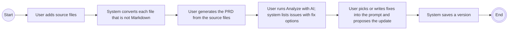
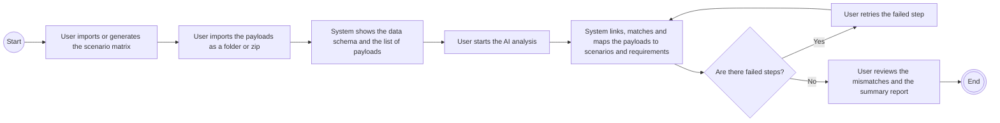

# DocHub

From Requirements to Architecture Design

> AI should NOT define the requirements. AI can NOT make the decisions. AI will NOT own the responsibility.

## 1. Purpose
Help a team turn several source PRDs into one consolidated PRD, and keep the requirements, scenario matrix, test plan, payload evidence and architecture design consistent with it. AI proposes and checks; people decide. A proof of concept and proof of value (POC/POV) exists today; this PRD describes it and the next steps.

### 1.1 Problem
- Requirements live in several Word and PDF documents with different structure and wording.
- Scenario matrices, test cases, payload files and design documents are edited separately and drift apart.
- Real system payloads (JSON, XML, CSV) are not tied to the scenarios and requirements they prove.
- Conflicts and gaps are found late, during build or test.

### 1.2 Users (assumed, to confirm)
| Role | Needs |
| --- | --- |
| Business analyst | One standard PRD, requirements and BPMN without retyping |
| Solution architect | A design backed by payload evidence, a clear list of gaps and decisions |
| QA or test lead | A scenario matrix traced to requirements and payloads, with coverage |
| Product owner | One place to see what is decided, missing or in conflict |

### 1.3 Goals and success measures
- Consolidate source PRDs into one standard PRD in one session.
- Tie every scenario to the real payloads that prove it, and every payload to requirements.
- Report conflicts, gaps and missing coverage across all artifacts in one check.
- Reach a design draft where every decision is traced to evidence and the user's choices.
- Success measures are to be set with the owner (see open items).

## 2. Scope
### In scope
- Source documents in Word, PDF, Office, CSV and Markdown; Markdown is used as it is, the rest is converted with MarkItDown
- One consolidated PRD (Generate PRD, AI with a document template) with scope, business BPMN and all requirements, editable, editable, with AI analysis, fix options and AI updates
- Requirements, scope and BPMN read from the PRD
- Scenario matrix: import, AI generation, categories, priorities, Excel export
- Test plan as the baseline for Playwright tests
- Payload library from folders, zips and files in JSON, XML and CSV, with data schema, evidence list and AI analysis
- Architecture design with references (documentation connections and project documents), AI readiness check, solutions with pros and cons, generation and updates
- Document templates for the PRD, architecture design, payload summary report
- Several AI models: the Claude CLI and OpenAI-compatible providers, chosen per step and per design
- Data folder inside OneDrive, shared with the team through OneDrive, with an export folder of Markdown files and a README
- Cross check across all pages, AI build plan, designs folder storage, themes, exports

### Out of scope
- Running tests (planned for a later release)
- Direct SharePoint or Graph sign-in (the OneDrive folder is the integration)
- Several people editing the same design at the same time
- Hosting as a public service
- Training or fine-tuning a model

## 3. Processes
### 3.1 Consolidate source PRDs
1. User adds source files
2. System converts each file that is not Markdown
3. User generates the PRD from the source files; the AI merges them using the template
4. User runs Analyze with AI; system lists known issues and pending decisions with fix options
5. User picks or writes fixes into the prompt and proposes the update
6. System saves a version

### 3.2 Prove scenarios with payloads
1. User imports or generates the scenario matrix
2. User imports the payloads as a folder or zip
3. System shows the data schema and the list of payloads
4. User starts the AI analysis
5. System links, matches and maps the payloads to scenarios and requirements
6. Are there failed steps?
7. User retries the failed step
8. User reviews the mismatches and the summary report

### 3.3 Design and keep consistent
1. System checks the readiness of the design
2. User decides the key options
3. System generates the architecture design
4. User edits any artifact
5. System marks dependent results as out of date
6. User runs the cross check
7. User decides what to fix

## 4. Requirements
### 4.1 Source documents and consolidated PRD
| ID | Requirement | Source |
| --- | --- | --- |
| R-01 | The tool accepts source files of up to 50 MB and opens each original read-only through a link. | POC, page 1 |
| R-02 | A source file that is already Markdown is used as it is and shows as ready, also after it is edited and synced from the folder. The tool converts every other source file to Markdown with MarkItDown, using the MCP server in `config/markitdown.mcp.json`, and falls back to the Python package when the server fails. | POC, page 1 |
| R-03 | The tool shows which engine converted each file and the reason when a conversion fails. | POC, page 1 |
| R-04 | Generate PRD uses the AI to read all the source files and merge them into one PRD in the chosen template (default: Standard Agile PRD Structure) or, without a template, the structure that fits the content best. The PRD always calls out the Scope (in and out), the business processes with a BPMN-style diagram each (business steps and roles, not technical implementation) and a table of all requirements with their sources. Source IDs are kept, duplicates are merged, contradictions become open questions, requirements the AI adds are marked proposed, and unknown values are TBD. The result is checked (scope, diagrams, requirement IDs missing from the PRD) and the user's PRD is kept until a replacement is confirmed. When AI cannot run, nothing changes. | POC, page 1 |
| R-05 | The user can edit the PRD as Markdown, copy it, paste it, import a Markdown file and export it as Markdown, JSON, requirements CSV, PDF, CLAUDE.md and AGENTS.md. | POC, page 1 |
| R-06 | Every replacement of the PRD saves a version; the user can compare a version with the current text and restore it. | POC, page 1 |
| R-07 | After Analyze with AI the tool lists known issues by type (conflict, decision needed, gap, wording) with a severity; related points are grouped into one entry. The user can dismiss an issue and pick or write a fix (R-97). The list is empty until the analysis runs and is cleared when the PRD is regenerated, imported or pasted. | POC, page 1 |
| R-08 | On demand, the AI analyses the PRD for key missing content, unclear or untestable requirements, TBD items and logic problems, reports only Critical and Important issues (R-98), and shows them with the built-in checks, AI findings marked AI. | POC, page 1 |
| R-09 | The user can update the PRD from a free-text instruction; the AI changes only what was asked, keeps IDs stable, and the user reviews a diff and accepts or discards it, with undo. | POC, page 1 |

### 4.2 Requirements and BPMN
| ID | Requirement | Source |
| --- | --- | --- |
| R-11 | The requirements page is a view of the consolidated PRD, read each time it opens; the user changes content only in the PRD. It has no document, download or template of its own. | POC, page 2 |
| R-12 | The page lists in-scope and out-of-scope items, every requirement with its source and status, and one BPMN diagram per process. | POC, page 2 |
| R-13 | A process without a diagram in the PRD gets a diagram drawn from its numbered steps, with a decision for every step that ends in a question mark. | POC, page 2 |
| R-14 | Each section has a button that opens the PRD editor at the matching section. | POC, page 2 |

### 4.3 Scenario matrix
| ID | Requirement | Source |
| --- | --- | --- |
| R-15 | The AI generates the scenario matrix from the full PRD and its requirements as journeys and variations: one scenario lists all the requirement IDs it proves, every requirement is covered, requirement IDs are checked against the PRD, and categories are high level (the AI's own list, usually 5 to 12). Every P0 and P1 scenario is generated without a limit; P2 and P3 are kept to a minimum. There is no simulated fallback. | POC, page 3 |
| R-16 | The matrix columns are ID, Channel, Name, Category, Type, Priority and Payload, then the AI fields Scenario, Requirements and Expected outcome, which are read only. Other imported columns are kept and exported but hidden by default. | POC, page 3 |
| R-17 | The tool imports a matrix from Excel, CSV or pasted cells. Only a key column is required: Name (a plain Scenario or Description column is read as the Name) or Scenario ID. All other columns are optional. | POC, page 3 |
| R-18 | The AI fields are blank after an import and are generated from the matched payloads. A file in the tool's own layout keeps its values. | POC, page 3 |
| R-19 | Changing a column mapping re-reads the file at once and refreshes the table; generated AI fields are kept for the same IDs. The user can undo an import and refresh from a linked workbook. | POC, page 3 |
| R-20 | Scenarios have two levels, Category and Type (happy, edge, negative, gap), and the table filters by Category, Type, Channel and Priority. | POC, page 3 |
| R-21 | Every scenario has a priority of P0 to P3 or Not required; Not required is left out of coverage and checks. The definitions are shown on the page and used by the AI: P0 Critical (core end-to-end, blocks release or go-live, every build), P1 High (primary happy paths and common variations, full or major-release regression), P2 Medium (less frequent, secondary variations, acceptable workarounds, planned regression), P3 Low, edge or future (rare edge cases, complex combinations, future scope, as needed). | POC, page 3 |
| R-22 | The Payload column can name several payloads, and a payload can serve several scenarios. | POC, page 3 |
| R-84 | A matrix generated from the requirements carries the requirement IDs, and keeps them when exported, edited and imported again. | POC, page 3 |
| R-85 | For a matrix that was imported or typed by hand, the AI links each scenario that has no requirement to requirement IDs, using the scenario's name, category, type, channel, other columns and its linked payload when there is one; IDs already written in the row are adopted, IDs outside the PRD are dropped, and failed scenarios can be retried alone. | POC, page 3 |
| R-86 | A requirement traceability table shows, for every requirement, its scenarios and the payloads linked through them, and flags requirements with no scenario or no payload. | POC, page 3 |
| R-23 | The user can edit every editable cell, add and delete rows, and changes save without a save button. | POC, page 3 |
| R-24 | A summary and checks compare the matrix with the PRD: unknown requirement IDs, requirements with no scenario, and conflicting numbers, approvals or channels. | POC, page 3 |
| R-25 | The AI reviews the matrix for quality issues and suggests missing scenarios (P1 key, P2 edge), and the user can add a suggestion to the matrix. | POC, pages 3 and 5 |
| R-26 | The tool exports the matrix to Excel with a traceability sheet, and offers a matrix template. | POC, page 3 |

### 4.4 Test plan
| ID | Requirement | Source |
| --- | --- | --- |
| R-27 | The tool creates one test case for every scenario that is not Not required, and never overwrites an existing one. | POC, page 4 |
| R-28 | The user can add, edit and delete test cases, including steps, expected result, drive type (UI or API), priority and status. | POC, page 4 |
| R-29 | Clicking a test case opens its detail with a Playwright skeleton marked as not implemented. | POC, page 4 |
| R-30 | The user can refine a test case with a prompt, review a diff, accept or discard it, and undo. | POC, page 4 |
| R-31 | A coverage view by priority shows which scenarios have a test case, a payload, both or neither. | POC, page 4 |
| R-32 | The tool exports the plan as Markdown and CSV, and the skeletons as a zip. | POC, page 4 |
| R-77 | Test refinement runs through the AI model chosen for the step, shows the proposed fields and Playwright skeleton as a diff, and applies only when accepted, with undo. | POC, page 4 |

### 4.5 Payload library
| ID | Requirement | Source |
| --- | --- | --- |
| R-33 | The tool imports payloads from a folder, a zip or single files in JSON, XML or CSV (mixed is allowed, up to 5,000 files), converts them to one structure, and offers a payload template. | POC, page 5 |
| R-34 | Each top-level folder is one payload (for example a sales order). Its primary file is the primary payload and its sub-folders hold the related payloads. Wrapper folders and stray files next to the payload folders are ignored, and IDs compare without case and hyphens. | POC, page 5 |
| R-35 | Every import works like extracting a zip into a folder: a file with the same path is overwritten, a new path is added. An import history shows for each import the files, the new files, the overwritten files and the files still from it, and one import can be removed. If earlier files cannot be loaded, the import is refused. | POC, page 5 |
| R-36 | The page starts with a data schema: an ER diagram of the structure all payloads share, limited to the entities that matter most to the requirements and the design, always showing the root entity with its links. Payload headers such as the folder or file named by the payload ID are never entities or fields. | POC, page 5 |
| R-37 | For each entity the schema lists what is common to all payloads, what differs between payloads, what is inconsistent, and the requirement IDs it impacts. The user can show all entities or redraw the diagram with the AI. | POC, page 5 |
| R-38 | Below the schema, a list shows one row per payload with its scenario, matrix columns, files per related folder and the key facts found in the JSON, highlighting values that differ from the other payloads and fields that are missing. | POC, page 5 |
| R-39 | Selecting a payload shows, in a panel of the same height on the right, its row, a summary of the JSON, its scenario and AI findings, and the source of the primary payload and every related payload as code blocks. | POC, page 5 |
| R-40 | One button, available only when payloads and a matrix exist, runs the analysis in six steps with progress: link payloads to the matrix by ID, match the remaining payloads to scenarios with AI, generate scenario, expected outcome and requirements, compare the matrix with the payloads and review it, map payloads with scenarios and requirements, write the summary report. | POC, page 5 |
| R-41 | When a step fails the tool keeps the finished work and offers a retry from that step; for the generate step it can retry only the scenarios that failed, and it retries a failed batch one scenario at a time. | POC, page 5 |
| R-42 | The tool lists mismatches between what each matrix row expects and what its payloads show, by severity, and a mapping of payloads to scenarios to requirements with the requirements that have no payload. | POC, page 5 |
| R-43 | The summary report is short: a TL;DR, key mismatches, fields that differ, matrix issues, suggested scenarios and the key data model, with no file or ID lists. | POC, page 5 |
| R-44 | The page shows coverage of scenario, test case and payload, a folder inventory, and the evidence gaps (payloads named in the matrix with no folder, folders no scenario names). | POC, page 5 |
| R-45 | Reset removes the payloads, their analysis and report, and what they added to the matrix: the Payload column returns to the source file's values and the AI fields they generated are blanked. | POC, page 5 |

### 4.6 Architecture design
| ID | Requirement | Source |
| --- | --- | --- |
| R-46 | The design can be generated without the payload library or the test plan. | POC, page 6 |
| R-47 | Before generating, the AI checks the PRD, requirements, matrix, test cases and payloads and lists Missing, Confirm, Conflict and Risk issues by severity; the user can dismiss an issue or copy it into the update prompt. | POC, page 6 |
| R-48 | A separate step, Find solutions, is available on its own or after the readiness check, also when a design already exists. Where the design has real alternatives, the tool shows each option with choices, pros, cons and a recommendation, and requires a choice before the design is generated; every option also has a manual choice (own name, summary, pros, cons), and the user can add a decision manually; with an existing design, the chosen decisions can be added to the update prompt. Unresolved issues become open items in the design. | POC, page 6 |
| R-49 | The generated design is short and concise, follows the user's choices, and is editable Markdown with copy, paste, import, export and undo replace. | POC, page 6 |
| R-50 | The user can update the design from a free-text instruction and review a diff before accepting. | POC, page 6 |
| R-51 | The user can start from a blank design or an imported one. | POC, page 6 |
| R-88 | Reference connections of two kinds, a documentation website (any official docs address) or an MCP server (for example Microsoft Learn), are kept once for the whole team in the `_config` folder inside the data folder; the Designs page adds (https), tests and removes them. Local programs are added by editing the shared file and run on a computer only after the user approves them there; tokens stay on the user's own computer. | POC, designs list |
| R-89 | Each design chooses which connections the AI may query, and holds project reference documents (text, or Word, PDF and Office converted with MarkItDown, or pasted) that apply to that design only. | POC, page 6 |
| R-90 | Readiness check, Find solutions, design generation and design update use the chosen connections and the project documents. The generated design links the exact pages it used in a Sources table, and links to connected sites are checked and marked when not found. | POC, page 6 |

### 4.7 Cross check and readiness
| ID | Requirement | Source |
| --- | --- | --- |
| R-52 | The cross check can run at any time and covers every page that has data (PRD issues once analysed, requirements, matrix, test cases, payloads, design, build plan); pages without data are listed as not compared and never block it. It never changes data. | POC, pages 1 to 6 |
| R-53 | Findings have a colour-coded severity (Critical, Important, Minor), are sorted most severe first, can be filtered by severity, type and area, and can be dismissed. Findings with one cause are grouped, and Minor ones are hidden until requested. | POC, pages 1 to 6 |
| R-54 | The result is the same on every page and is marked out of date when compared data changes. | POC, pages 1 to 6 |
| R-55 | The architecture page shows a verdict (Blocked, Ready with risks, Ready); Blocked applies only when there is no PRD or no requirements. | POC, page 6 |

### 4.8 Build plan
| ID | Requirement | Source |
| --- | --- | --- |
| R-56 | The tool groups requirements into modules, maps dependencies and build waves, and breaks the work into tasks with scenarios to verify. | POC, page 7 |
| R-57 | The user can edit implementation guardrails, which are written into CLAUDE.md and AGENTS.md. | POC, page 7 |
| R-87 | The build plan (modules, dependencies, tasks, estimates) is generated by the AI model chosen for the step from the requirements and scenarios; when AI cannot run, nothing is generated. | POC, page 7 |

### 4.9 Designs, storage and navigation
| ID | Requirement | Source |
| --- | --- | --- |
| R-58 | A designs list lets the user create a blank design, rename it, open it, delete it after a second click, and export and import all designs; it shows where designs are saved. | POC, designs list |
| R-59 | With the helper service each design is a folder, named after the design, with one sub-folder per step; without it designs stay in the browser. | POC, all pages |
| R-108 | Configuration the team shares, the reference connections and the document templates (with their defaults), is stored in one `_config` folder inside the data folder and is the same for everyone; the Document Repo, the user's name, the AI models, keys and tokens stay on the user's own computer. | POC, designs list |
| R-107 | The tool runs the same on macOS and Windows, with a launcher for each. Another user installs it, adds the team folder to their OneDrive, chooses it as the data folder and sees the same projects; settings, keys and paths that belong to one computer are never stored in the shared project, and a conflict copy made by OneDrive is shown to the user. | POC, launcher, designs list |
| R-106 | Design names are unique (case does not matter) because the design name is the project folder name; creating, renaming or importing a design never overwrites another, characters the file system refuses are replaced, and renaming the design renames its folder. | POC, designs list, design bar |
| R-60 | The user can sync edited files back from the shared folder and save everything to it on demand. | POC, all pages |
| R-94 | The Claude CLI stays built in; any OpenAI-compatible service (OpenAI, DeepSeek, NVIDIA NIM, AMD or other vLLM servers, Azure OpenAI, GitHub Models, Ollama) can be added once, with presets, a connection test and a model list, and keys that never reach the browser. | POC, designs list |
| R-95 | A default model and a model per AI step are chosen globally; the model used is recorded with each AI result. | POC, designs list, design bar |
| R-96 | Documentation connections work with every model that supports tool calls; the helper runs the tool loop for non-Claude models and refuses clearly when the model cannot call tools. | POC, page 6 |
| R-109 | The architecture page has a design review like the PRD's analysis: on request the AI reads the design against the PRD, the requirements and the solutions the user chose, and lists only critical and important issues with fix options; it is lenient, and an empty result is shown as a normal outcome. | POC, page 6 |
| R-110 | When an accepted update applies the fix chosen for an issue, that issue is marked Resolved in its row, on the PRD page and on the architecture page, and stays in the list with the fix that resolved it; the user can also mark an issue resolved or reopen it. | POC, pages 1 and 6 |
| R-111 | The architecture page accepts, as its first step and instead of importing an existing design, an optional baseline architecture draft (import or paste, read-only, replace or remove). It is added to the AI context of the readiness check, Find solutions and design generation as the base document. When Find solutions returns several options and the draft already chose one, that choice is selected automatically and marked as taken from the draft (the user can choose another); the design can be generated once all options are decided and all readiness items are resolved or dismissed. | Must |
| R-112 | Inside a design, an AI models bar above the seven steps shows the default model and lets the user change the default and the model of each step (saved on this computer only). There is no separate per-design model button. | Should |
| R-113 | The architecture page has a Reset (confirmed by a second click) like pages 1, 3, 4 and 5: it clears the design, the readiness check, the options and decisions, and the design review, and keeps the version history, the baseline draft, project documents and connections. | Should |
| R-114 | AI steps run on the helper as background jobs. Reloading or closing the page does not stop them; pressing the same button again joins the running or finished job instead of starting a new one, and identical requests running at once share one job. | Must |
| R-115 | The readiness check is lenient: it lists conflicts between documents (requirements, scenarios, tests, payloads, baseline draft, current design), missing information and important assumptions. Each item has suggested changes (several can be selected; for a conflict, which side wins) or the user's own input, and Dismiss. Before the design exists, a prominent Mark resolved button saves the selection as a decision together with the solution options; decisions are binding for the design, every item must be resolved or dismissed before generation, and there is no Add my fix. After the design exists, Mark resolved is replaced by Add my fix, which adds the fix to the update prompt and saves the decision; changing a solution option adds its line to the prompt. Check again and Find solutions again read the current design. The design keeps a version history like the PRD. | Must |
| R-116 | The design review (Analyze with AI) finds issues in the generated design and offers fixes that are added to the update prompt. It runs automatically after every generation or regeneration of the design, and on request. | Must |
| R-117 | Reset on the PRD page and the architecture page first saves the current text as a Before reset version and keeps the version history. The version history is the last panel on both pages and is always visible. | Must |
| R-97 | Every AI issue on the PRD page and the Architecture page comes with two or three suggested fixes. Clicking a fix adds it as a bullet to the update prompt below (clicking again removes it); the user can also write their own fix for the issue. Nothing changes until the user presses Propose the update, and then reviews the diff. | POC, pages 1 and 6 |
| R-98 | AI analysis and the cross check report only what matters (missing key information, logic problems, conflicts, real open decisions). Related findings with one cause are shown as one entry that names the affected items and offers one set of fixes; minor findings are hidden until the user asks for them; the AI is limited to 12 issues for the PRD and 10 for the readiness check. | POC, pages 1 to 7 |
| R-101 | A template library (Designs page) keeps document templates as Markdown files, pasted or uploaded, each for a document type (PRD, Architecture design, Payload summary report: three in all), with a default per type. The Standard Agile PRD Structure is preset. | POC, designs list |
| R-102 | The AI follows the template of the document it writes: the PRD, the architecture design, and, by reshaping a fact draft without losing content, and the payload summary report. A design can choose another template or let the AI decide; with no template the AI chooses the best-fitting structure. | POC, pages 1, 5, 6 |
| R-103 | Diagrams keep the swimlane style; lines are elbows that cross as little as possible, with a bridge where a crossing cannot be avoided; the reader accepts the usual Mermaid forms; and every diagram has controls to drag, zoom, fit, open full screen, copy the source, download SVG or PNG, and show the same diagram with the official Mermaid layout for comparison (the library is loaded only on request). ER diagrams are drawn as refined entity cards with crow's-foot ends and elbow lines, with the official layout one click away. Diagram types other than flowchart, graph and ER, such as sequence diagrams, are drawn by the official Mermaid library only. | POC, all pages |
| R-104 | The AI runs only when the user presses a button; opening a page, a design or syncing a folder never starts an AI call, and the tool refuses an AI call that no button press started. | POC, all AI steps |
| R-105 | The project data is kept apart from the application in a folder the user sets inside OneDrive; OneDrive signs in as the user and shares the folder with the team, and the user decides how the team folder reaches their OneDrive. Settings are local. Changes are captured with OneDrive version history, a change banner every 30 seconds, a soft lock per project, a stale-save check and an activity log, and the PRD and the architecture design keep labelled versions that can be compared with the current text and restored. A damaged `design.json` is repaired or shown as unreadable, never hidden. | POC, designs list, design bar |
| R-91 | Each design can name an export folder (for example inside OneDrive). Save all writes every page as Markdown (workbook for the matrix) plus a README that lists the files, sources, references, AI used and how the files were generated; Sync from folder reads back the PRD, matrix workbook, design and reference documents that were edited there. | POC, design bar |
| R-61 | A continue button runs the next page and another runs every remaining page. | POC, all pages |
| R-62 | Pages 1, 3, 4 and 5 each have a reset that clears only that page's data after a second click. | POC, pages 1, 3, 4, 5 |
| R-63 | The tool offers five colour themes and a night mode, remembers the choice and follows the system setting on the first visit. | POC, top bar |
| R-64 | The tool ships no sample data and has no downloadable import templates; the document templates are in the template library (R-101). | POC, pages 1, 3, 5 |

### 4.10 AI platform
| ID | Requirement | Source |
| --- | --- | --- |
| R-65 | All AI runs through the helper service, either the Claude CLI (built in; when `.foundry.env` exists it alone decides the provider, Microsoft Foundry, and other Anthropic or login variables are ignored) or an OpenAI-compatible provider (R-94). | POC, server |
| R-66 | A launcher asks for the Foundry details once, saves them in an owner-only file, checks that Claude answers and starts the service. | POC, launcher |
| R-67 | When AI cannot run the tool shows the reason (CLI missing, not signed in, key refused, model without tool support, service out of date, too much data, timeout) and changes nothing. It never shows simulated AI output. | POC, all AI steps |
| R-68 | Every AI step shows progress with elapsed time and disables its button while running. | POC, all AI steps |
| R-69 | AI changes to a document are shown as a diff and applied only when the user accepts; AI findings are limited to Critical and Important issues. | POC, pages 1 and 6 |
| R-70 | AI output is short: bullets and tables, one short sentence per field, no repeated lists of IDs or names, and the architecture design about 100 lines. | POC, all AI steps |

### 4.11 Interface and non-functional
| ID | Requirement | Source |
| --- | --- | --- |
| R-71 | Pages use the full width. Every section collapses, with a collapse-all control per page; long tables scroll inside a fixed-height box with a sticky header; section titles are on the left and actions on the right. | POC, all pages |
| R-72 | Lists with a detail (test plan, payload library) show the list on the left and the selected item on the right, both the same height. | POC, pages 4 and 5 |
| R-73 | The helper service listens on the local machine only and rejects file names, identifiers and folder names that could reach outside the data folder. | POC, server |
| R-74 | Markdown previews draw only mermaid, svg and html blocks, remove scripts, event handlers, frames, forms and external loads, and show every other block as plain code. | POC, previews |
| R-75 | The interface works with the keyboard, labels icon buttons, shows status as text, shows severity as text as well as colour, and respects the reduced motion setting. | POC, all pages |
| R-76 | The tool runs without a build step and without network access other than the font download. | POC, all pages |

## 5. Proposed requirements
| ID | Requirement | Source |
| --- | --- | --- |
| R-78 | The tool runs the Playwright tests from the test plan and writes results and payloads back to the payload library. | AI proposal |
| R-79 | The tool signs users in and restricts each design to the users it is shared with. | AI proposal |
| R-80 | The tool stores designs in a database or repository, with history and conflict handling. | AI proposal |
| R-81 | The tool reads a matrix workbook and OneDrive version history directly through Microsoft Graph (needs an app registration). | AI proposal |
| R-82 | The tool draws sequence and other Mermaid diagram types. | AI proposal |
| R-83 | The tool keeps AI provider keys and connection tokens in a secrets store instead of owner-only local files. | AI proposal |
| R-92 | The tool shows cost and time per AI call and compares two models side by side on the same step. See DESIGN.md backlog B-10. | AI proposal |
| R-99 | Microsoft 365 Copilot (Graph Chat API) is available as a provider, with delegated sign-in. See DESIGN.md backlog B-21. | AI proposal |
| R-100 | Fix options and an update prompt are available for the matrix review and payload findings. See DESIGN.md backlog B-23. | AI proposal |
| R-93 | Rule-based stand-ins and unused code are replaced or removed. See DESIGN.md backlog section 17.1. | AI proposal |

## 6. Open items
- Who owns this PRD and the success measures for the proof of value?
- Which models, hosted where, may process the documents and payloads (Claude on Foundry, OpenAI-compatible services, local models)?
- Which documentation sources are approved as official references for generated designs?
- Where may source documents, payloads and generated files be stored?
- Who owns the parsing and check rules and the AI prompts, and how are they tuned?
- Confirm the user roles in section 1.2.
- Run the browser test and a trial on real documents and payloads, and record the findings.
- Rename the folder and storage keys that still carry the first version's names, with a migration for saved designs.
